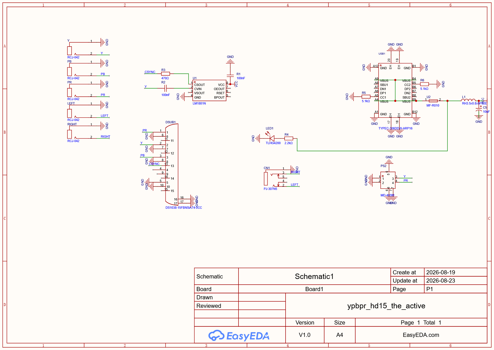

# Extron HD15 Analog Video Autoswitch Adapter

A through-hole adapter for feeding **YPbPr component video, S-Video, or composite video over the Y/green channel** to compatible Extron HD15 inputs. Its LM1881 separates composite sync from the Y/CV signal and sends it to HD15 pin 13 so an Extron device can detect the input for automatic switching.

The board also brings stereo RCA audio to a 3.5 mm jack. USB-C supplies 5 V for the sync separator and power indicator.

*PCB1 layout preview. Review the Gerber files in a fabrication viewer before ordering; this image is not a manufacturing drawing.*

## What it carries

| Source | HD15 destination | Notes |
| --- | --- | --- |
| Pr RCA, or S-Video chroma via the 4-pin mini-DIN | Pin 1 | Red-position signal path |
| Y/CV RCA, or S-Video luma via the mini-DIN | Pin 2 | Green-position path; also feeds the sync separator |
| Pb RCA | Pin 3 | Blue-position signal path |
| LM1881 composite-sync output | Pin 13 | Through a 470 Ω series resistor; used for input detection |
| Video returns | Ground pins | Common ground |

The left and right RCA jacks connect to the 3.5 mm stereo jack. The mini-DIN's luma and chroma connections share the Y and Pr paths, respectively. Choose one intended video source at a time.

**This is a signal-routing and sync adapter, not a YPbPr-to-RGB color converter or a video scaler.** The receiving Extron input must support the signal format and timing being supplied. Auto-switching depends on that device's configuration and sync-detection behavior.

*Schematic1 for Board1, the design represented by the manufacturing files below.*

## Files

| File | Purpose |
| --- | --- |
| [Gerber ZIP](hardware/Gerber_PCB1_2026-11-14.zip) | PCB fabrication export with copper, masks, silkscreen, outline, and plated/non-plated drill files |
| [BOM export](hardware/BOM_Board1_PCB1_2026-11-14.csv) | Original EasyEDA parts export; tab-delimited despite the `.csv` extension |
| [Pick-and-place workbook](hardware/PickAndPlace_PCB1_2026_11_14.xlsx) | Original component-position export; all 20 listed placements are through-hole |
| [Readable BOM](docs/BOM.md) | Parts and supplier identifiers transcribed from the original BOM |
| [Build and wiring notes](docs/BUILD.md) | Connector mapping and checks before use |

These exports are for **Board1 / PCB1**. The source EasyEDA archive also contains a separate SMD board, so that combined editable project is not included here. The two preview images above are limited to Board1 and Schematic1.

## Fabrication and assembly

The supplied BOM contains **20 parts across 17 rows**. Download the Gerber ZIP, review its layers and drill files with your board manufacturer's viewer, then use the [BOM](docs/BOM.md) and [build notes](docs/BUILD.md) to assemble and check the board. The placement workbook is a reference for component positions and rotations; it is not an automated SMD assembly file.

No physical test results or device compatibility matrix accompanied these exports. Check the pinout, power polarity, sync behavior, and the receiving Extron input before connecting equipment.

## Related projects

The repository layout follows the same manufacturing-file and build-note approach as [Bi-Directional 3.5 mm Phoenix Adapter](https://github.com/ihategravel2/Bi-Directional-3.5mm-Phoenix-Adapter) and [10-Pin Phoenix Audio Adapter](https://github.com/ihategravel2/10Pin-Phoenix-Audio-Adapter).

