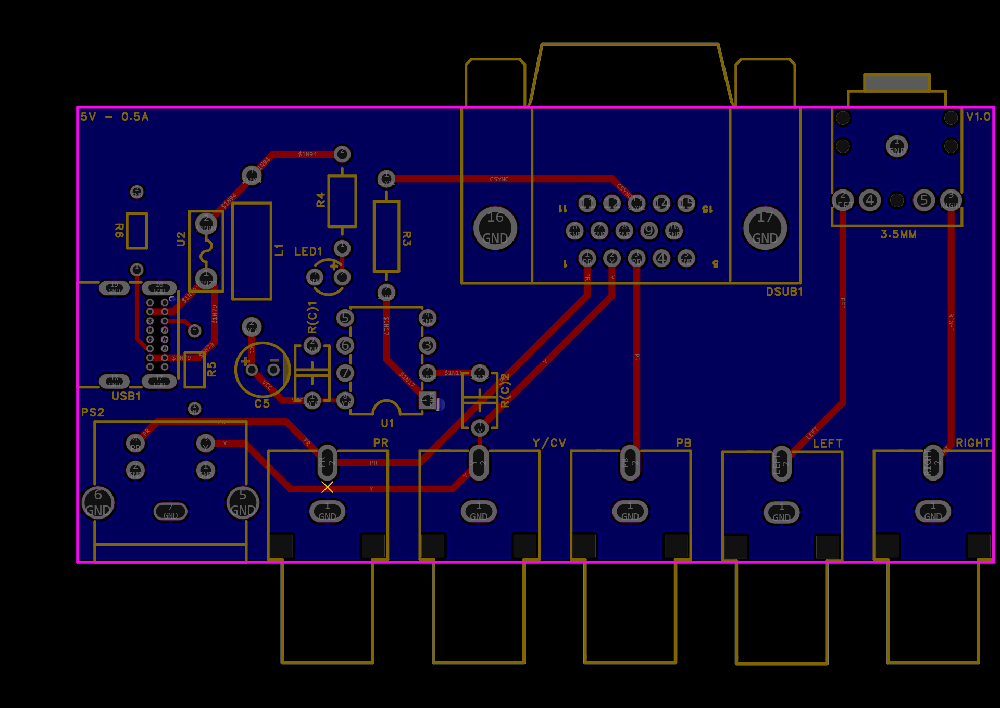
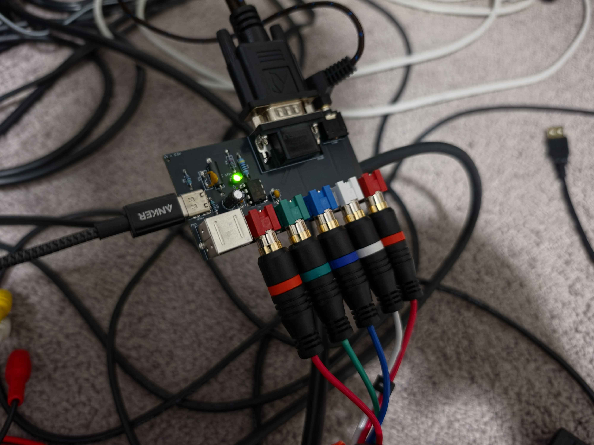

# Extron HD15 Analog Video Autoswitch Adapter

This through-hole adapter accepts YPbPr component, S-Video, or composite video and connects them to a compatible Extron HD15 input. The Y (luma) or composite signal goes to the HD15 green channel. An LM1881 also extracts sync from that signal and sends it to HD15 pin 13, allowing the Extron device to detect the source and switch to it automatically.

# ONLY MEANT FOR 15KHZ! (e.g 240p, 480i)

The board also brings stereo RCA audio to a 3.5 mm jack. USB-C supplies 5 V for the sync separator and power indicator.

*PCB1 layout preview. Review the Gerber files in a fabrication viewer before ordering; this image is not a manufacturing drawing.*

## Bill of materials

The [source BOM](hardware/bom.xls) contains footprints, JLCPCB part numbers, and order quantities. Its `Comment` field uses generic or older names for some connectors, so the connector names below follow the selected-parts list and its matching JLCPCB part numbers. Quantities in this table are placements for one board.

| Designator | Part / value | Qty per board | JLCPCB part # |
| --- | --- | ---: | --- |
| LEFT | RCJ-043 RCA jack | 1 | C4992825 |
| LED1 | TLHG4200 LED | 1 | C6333075 |
| U2 | MF-R010 resettable fuse | 1 | C89660 |
| U1 | LM1881N sync separator | 1 | C518923 |
| 3.5MM | PJ-307N5 audio jack | 1 | C692542 |
| PS2 | KMDGX-4S-BS S-Video jack | 1 | C6212927 |
| Y/CV | RCJ-046 RCA jack | 1 | C4991830 |
| USB1 | TYPEC-306DDW-ARP16 USB-C jack | 1 | C2840393 |
| R(C)1, R(C)2 | 100 nF capacitors | 2 | C1622885 |
| DSUB1 | DS1038-15FBNSiA74-0CC HD15 connector | 1 | C75754 |
| C5 | 10 µF capacitor | 1 | C19712075 |
| R4 | 2.2 kΩ resistor | 1 | C172526 |
| PB | RCJ-045 RCA jack | 1 | C4992698 |
| R3 | 470 Ω resistor | 1 | C58592 |
| L1 | RH3.5x0.8x9P52E ferrite bead | 1 | C192455 |
| PR, RIGHT | RCJ-042 RCA jacks | 2 | C4991949 |
| R5, R6 | 5.1 kΩ resistors | 2 | C119195 |

The [Same Sky MD-40SM at DigiKey](https://www.digikey.com/en/products/detail/same-sky-formerly-cui-devices/MD-40SM/96935) can also be used for the S-Video jack. Check the connector's mechanical fit and pinout against the PCB footprint before assembly.
